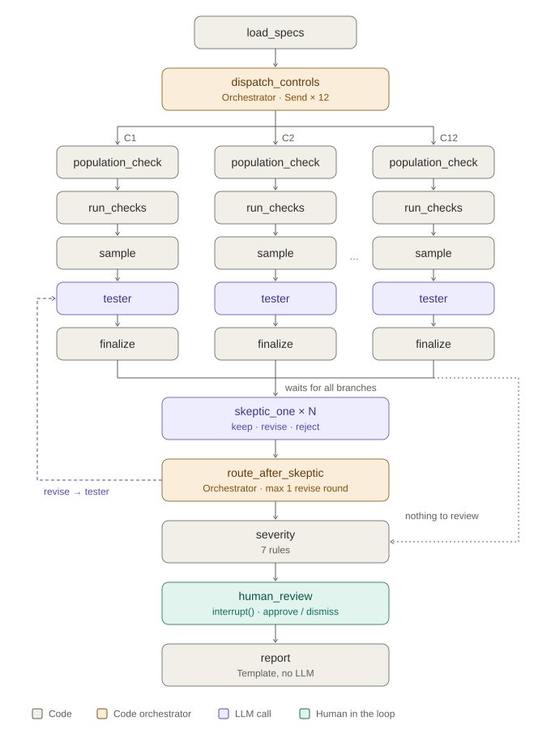

# Mock Audit Agent

A skeptical SOC 2 Type II mock auditor. It audits twelve controls at **Ledgerly**, a fictional B2B invoicing company, over a year of synthetic evidence. It predicts the exceptions a real auditor would raise before fieldwork starts, writes each one in auditor format (condition, criteria, cause, effect, recommendation), and cites the exact records behind it.

**Live showcase:** https://chiragsingla25.github.io/mock-audit-agent/ (published runs, findings with their step lists, recorded review decisions, and the comparison below)

> A readiness forecast from synthetic data, not an audit opinion. There is no pass badge anywhere: "no exceptions found" is not "passed".



## How it works

One LangGraph `StateGraph` runs the whole audit:

1. **Code runs every check on the full population.** Twelve plain functions in a `CHECKS` dict cover revocation delays, population reconciliation, segregation of duties, SLAs in calendar and business days, ISO weeks, and more. Code computes every count, date, SLA and severity (seven deterministic rules). The LLMs never do arithmetic.
2. **A tester (Qwen 3.5 Flash) judges what code flags.** It uses `create_agent` with three tools: `get_record`, `read_policy`, and `ask_owner` (a scripted walkthrough). For each candidate exception it raises a finding or dismisses it with a documented reason, citing the records it read. It also judges the steps code can't, such as whether a review sheet was signed in time. Code first hands it the computed due dates.
3. **A skeptic (DeepSeek V4 Flash, a different model family) reviews every finding** with keep, revise or reject. A revise sends only that finding back to the tester, once. A citation check drops any citation to a record that doesn't exist.
4. **A person approves or dismisses** each finding (`interrupt`), and the report contains only approved findings.

The rest is code too: `Send` fan-out across controls, reducers that merge findings by id (so a revision can't overwrite a reviewed finding), a SQLite checkpointer (review resumes in a fresh process), a spend guard, per-control timeouts and error isolation, and a `RetryPolicy` for provider blips.

## Results

Scored by code against each dataset's answer key: a finding matches a planted gap on control id plus at least one cited record id. The answer key has 10 planted gaps, 4 traps (exceptions with a documented innocent explanation, such as an employee converting to a contractor) and 4 clean controls. Variants A and B re-plant 7 of the gaps on different records.

Evaluation `eval-20261017T024416Z` (all runs are on the showcase):

| Dataset | Mode | Recall | Precision | Clean controls | Severity agreement | Traps raised |
|---|---|---|---|---|---|---|
| Ledgerly base | **Agent** | 10/10 | 10/10 | 4/4 | 10/10 | 0/4 |
| Ledgerly base | Checks only (rules baseline) | 8/10 | 8/10 | 2/4 | 8/8 | 4/4 |
| Variant A | **Agent** | 7/7 | 7/7 | 6/6 | 7/7 | 0/4 |
| Variant A | Checks only | 6/7 | 6/8 | 4/6 | 6/6 | 4/4 |
| Variant B | **Agent** | 7/7 | 7/7 | 6/6 | 7/7 | 0/4 |
| Variant B | Checks only | 6/7 | 6/9 | 4/6 | 6/6 | 4/4 |

- **Agent vs checks-only:** checks-only can't see the two judgment gaps (an unsigned review sheet, a restore test dated before the period), and it raises all four traps. The agent finds every gap and dismisses every trap with a cited reason.
- **Stability:** 100% overlap of kept findings across 3 base runs.
- **Skeptic on vs off:** identical in this evaluation. The skeptic kept every finding (one revise round, then keep). In earlier runs it sometimes cost a true positive, which is why the "skeptic off" view exists and why its value is reported, not assumed.
- **Citations:** 100% valid (every cited record exists).

**Cost:** about **US$0.014 and 110k tokens per 12-control audit**. The full evaluation (5 agent runs plus checks-only) cost US$0.07. The whole project, development included, stayed under US$1 of a US$10 cap.

**The human-reviewed run** on the showcase records the project owner's own decisions: 3 findings approved and 7 dismissed. Its scores count only the approved findings, so they show what was approved, not the agent's accuracy.

### Honest limits

- **Synthetic data:** a model can score perfectly against an answer key it was designed around. Traps, noise rows (mixed time zones, name-format mismatches, a same-day suspension later deleted, a scan run late in the same week) and re-planted variants make that harder, but they don't make it real-world evidence. The findings should be reviewed by a practitioner before anyone relies on the approach.
- **Step lists:** a finding's step list shows every tool call the tester made for its control, not only the ones about that finding.
- **Skeptic reasoning:** the skeptic's prose can misstate a policy even when its verdict is right.

## Run it locally

Needs [uv](https://docs.astral.sh/uv/) and Node 24. You need your own OpenRouter key only for agent runs; checks-only runs and the tests make no LLM calls.

```bash
cp .env.example .env                                  # add OPENROUTER_API_KEY (and LangSmith if you like)
cd backend && uv sync
uv run mockaudit gen --variant all                    # synthetic datasets (seeded, byte-identical)
uv run mockaudit run --checks-only --variant base     # rules-only baseline, free
uv run mockaudit run --variant base --review skip     # agent audit, about US$0.015
uv run mockaudit eval --run latest                    # score it
uv run mockaudit eval --all                           # full evaluation (US$2 cap)
uv run pytest && uv run ruff check .                  # tests use stub LLMs
```

The local app (start an audit, watch the 12 controls, review findings, export the report):

```bash
cd backend && uv run mockaudit serve                  # API on 127.0.0.1:8000
cd frontend && npm install && npm run dev             # http://localhost:3000
```

To publish runs to the showcase: `uv run mockaudit export-showcase <run ids> --eval <eval id>`, then push `main`. `pages.yml` builds the static site (`NEXT_PUBLIC_MODE=showcase`) and CI validates the committed JSON against the schemas.

## Repository

- `backend/src/mockaudit/`
  - `datagen/`: the Ledgerly generator, controls and policies
  - `checks.py`, `severity.py`, `graph.py`, `agents.py`, `llm.py`: the audit itself
  - `api.py`, `showcase.py`, `evaluation.py`, `scoring.py`: the app, the export and the scoring
- `frontend/`: Next.js 16 with one data layer for live (API) and showcase (static JSON) modes
- `data/ledgerly/{base,a,b}/`: generated evidence and answer keys
- `specs/2026-10-15-mock-audit-mvp.md`: the build spec, phase by phase, with every deviation recorded
- `docs/`: proposal, architecture, PRD, research; `docs/video-script.md` is the 2-minute walkthrough

**Stack:** LangGraph, LangChain `create_agent`, OpenRouter (`langchain-openrouter`), LangSmith tracing, FastAPI, Next.js + Tailwind, GitHub Actions and Pages.

## Roadmap (not in this MVP)

Recipe planner, skeptic escalation and reruns, sample extension, citation repair, the skeptic reviewing dismissals, a write-up quality judge, C6 approver-also-committed observations, screenshot evidence and vision, SQL over exports, an evaluation screen in the UI, per-finding step lists, cross-control checks, multi-framework mapping, live integrations, auth, and hosting live audits online.
