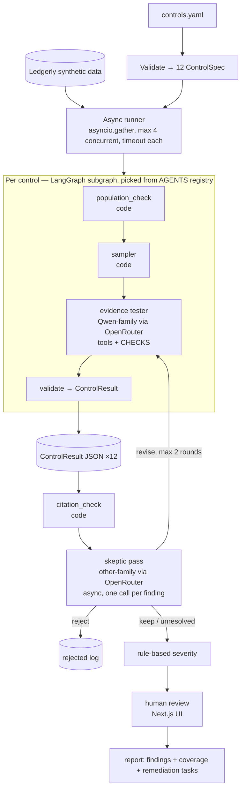

# Architecture — Mock Audit Agent

> **Superseded where it differs** by [proposal.md](proposal.md) (approved MVP, 2026-10-15) and [the spec](../specs/2026-10-15-mock-audit-mvp.md). Kept as background.


Status: **design preference** (from the 2026-10-14 discussion; updated 2026-10-15) · Read with `handover.md` and `PRD.md`.
The agent design below is a **preference**: app-architect may confirm or challenge it with evidence. The stack (LangGraph, OpenRouter, Next.js + FastAPI, GitHub Pages with offline runs), the US$10 cap and cheap cross-family models are **locked** (handover §8).

---

## 1. Design decisions (preference unless marked locked)

| # | Decision | Why |
| --- | --- | --- |
| D1 | **One async run per control**: `ControlSpec` in, validated `ControlResult` out | Focused context per control, failure isolation, clean traces, pluggable agents |
| D2 | **Code does the counting, the LLM does the judging** | Exact math, reproducible findings |
| D3 | **Two LLM roles only**: evidence tester and skeptic. No planner (recipes are hand-written), no interrogator agent (it's the `ask_owner` tool) | Fewer moving parts; agents only where judgment is needed |
| D4 | **Skeptic is a separate async pass** with its own registry | Swap reviewers without rerunning control agents; compare reviewers on the same findings |
| D5 | **Cheap cross-family models via OpenRouter** (locked): tester = a Qwen-family model; skeptic and judge = a different cheap family; US$10 total | Budget cap; LLM judges favour their own model family; one API and key |
| D6 | (locked) **LangGraph** for the per-control tester subgraph and its revise entry point | Tool loop, checkpointing and resumable revise; matches production experience |
| D7 | **Rule-based severity** (§6) | Deterministic and easy to defend; not set by any LLM |
| D8 | **Targeted revisions**: only `revise` findings rerun, only the tester step, max 2 rounds, then "unresolved" | Cheap, and honest when agents disagree |
| D9 | (locked) **Next.js frontend** with one data layer and two modes: **live** (local, talks to FastAPI) and **showcase** (static export reading pre-computed JSON) | Same screens locally and online |
| D10 | (locked) **Audits run offline (locally); results published as a static site on GitHub Pages.** Code on GitHub | Free, no secrets online, no public spend, nothing to keep awake; every published number is reproducible locally |
| D11 | **Coverage statement per control, no pass badge**; every approved finding becomes a remediation task | Avoids false confidence; output drives action |
| D12 | **Mandatory citations** and a code citation check before the skeptic | Primary guard against invented findings |

---

## 2. System overview



---

## 3. Components

| Component | Type | Responsibility |
| --- | --- | --- |
| Spec loader | Code | Load `controls.yaml`, validate into `ControlSpec` |
| Ledgerly generator | Code | Seeded synthetic company, evidence files, planted gaps, answer key, variants |
| Runner | Code (asyncio) | Launch control agents concurrently; persist results; contain failures |
| Control agent (`default`) | LangGraph subgraph | Population check → sampler → tester loop → structured `ControlResult` |
| Checks (`CHECKS`) | Code | Deterministic calculations a recipe step calls by name |
| Citation check | Code | Drop findings whose `record_id`s do not exist |
| Skeptic (`REVIEWERS`) | LLM call, structured output | Keep / revise / reject each finding |
| Severity | Code | Assign severity from rules (§6) |
| Report builder | Code + one LLM call | Auditor-format report, coverage, remediation tasks, short summary |
| Scorer and judge | Code + LLM judge | Evaluation metrics (§16) |
| API | FastAPI | Start runs, stream progress, serve results, record reviews |
| Frontend | Next.js | Live mode (API) and showcase mode (static JSON) |

---

## 4. Schemas (Pydantic, the contracts)

```python
class Frequency(str, Enum):
    event = "event"; continuous = "continuous"; daily = "daily"; weekly = "weekly"
    monthly = "monthly"; quarterly = "quarterly"; annual = "annual"

class EvidenceSource(BaseModel):
    name: str                       # "okta_events"
    path: str                       # "exports/okta_system_log.csv"
    role: Literal["population", "independent", "supporting", "policy", "artifact"]
    record_id_field: str | None     # column used as record_id for citations

class TestStep(BaseModel):
    id: str                         # "timeliness"
    description: str                # plain-language step
    check: str | None               # name in CHECKS, or None for pure judgment
    params: dict = {}
    judge: Literal["none", "llm"] = "llm"

class ControlSpec(BaseModel):
    control_id: str
    agent_type: str = "default"     # key into AGENTS
    description: str
    tsc: list[str]
    frequency: Frequency
    automated: bool
    risk: Literal["low", "moderate", "high"]
    owner: str
    period: tuple[date, date]
    evidence: list[EvidenceSource]
    test_recipe: list[TestStep]

class Citation(BaseModel):
    source: str
    record_id: str

class CheckResult(BaseModel):
    step_id: str
    record_id: str | None
    passed: bool
    detail: dict                     # e.g. {"hours_to_revoke": 129}

class Finding(BaseModel):
    finding_id: str
    control_id: str
    test_step: str
    gap_type: Literal["operating", "population_completeness", "segregation_of_duties",
                      "frequency_gap", "sla_breach", "evidence_out_of_period",
                      "missing_evidence", "design"]
    exceptions: int                  # items failing
    tested: int                      # items tested
    condition: str
    criteria: str
    cause: str | None
    effect: str
    recommendation: str
    citations: list[Citation] = Field(min_length=1)
    severity: Literal["low", "moderate", "high"] | None = None   # set by rules, never the LLM
    status: Literal["draft", "kept", "unresolved", "rejected", "approved", "dismissed"] = "draft"

class Coverage(BaseModel):
    tested: list[str]                # recipe step ids executed
    not_tested: list[dict]           # [{"step_id":..., "reason":...}]

class ControlResult(BaseModel):
    control_id: str
    status: Literal["pass", "exceptions", "error"]
    population_size: int
    population_complete: bool
    missing_from_population: list[str]
    sample: list[str]
    check_results: list[CheckResult]
    findings: list[Finding]
    coverage: Coverage
    owner_questions: list[dict]      # [{"q":..., "a":...}]
    agent: str
    model: str
    run_id: str                      # MLflow run / trace id
    revision_round: int = 0

class SkepticVerdict(BaseModel):
    finding_id: str
    decision: Literal["keep", "revise", "reject"]
    reason: str
    checks_failed: list[Literal["citation_mismatch", "out_of_period", "out_of_scope",
                                "innocent_explanation", "logic_error", "insufficient_evidence"]]
    reviewer: str                    # registry key + model id
```

Every control has its own spec: same schema, different values. If control families diverge later, `ControlSpec` becomes a Pydantic discriminated union (`kind: access | change | vuln ...`) that also routes to specialised agents.

---

## 5. Test recipes and checks

Each recipe step names a check (code), its params, and whether an LLM judges the result.

| Step type | `check` | `judge` | Example |
| --- | --- | --- | --- |
| Pure calculation | set | `none` | Population completeness, weekly scan gaps |
| Calculation, then judgment | set | `llm` | Code finds late revocations; LLM looks for valid explanations |
| Pure judgment | `null` | `llm` | Was the access review meaningful? Does the policy cover this? |

```python
CHECKS: dict[str, Callable[..., list[CheckResult]]] = {}

def check(name: str):
    def wrap(fn): CHECKS[name] = fn; return fn
    return wrap

@check("population_diff")       # completeness vs independent source
@check("revocation_delay")      # HR termination → first suspend/deactivate event
@check("approval_before_grant") # approval timestamp precedes grant
@check("periodic_occurrence")   # each quarter/week/year has an occurrence in period
@check("signoff_present")       # reviewer + date present on review artifact
@check("set_mismatch")          # e.g. IAM admins vs reviewed admin list
@check("author_ne_approver")    # segregation of duties on PRs
@check("unticketed_deploys")    # deploys with no linked PR/ticket
@check("sla_days")              # open → closed within N (business) days
@check("days_after_event")      # training within N days of hire
@check("date_in_period")        # evidence dated within observation period
@check("config_assert")         # automated config (e.g. MFA policy covers all groups)
```

New or more complex calculations are new registered functions, unit-tested against the answer key, with no change to the runner or agents. A future planner (v2) only picks checks and fills params.

**Example spec entry**

```yaml
- control_id: C2
  agent_type: default
  description: Terminated users lose access within 24 hours
  tsc: [CC6.3]
  frequency: event
  automated: false
  risk: high
  owner: IT Operations Manager
  period: [2026-01-01, 2026-12-31]
  evidence:
    - {name: hr_terminations, path: exports/hr_roster.csv, role: independent, record_id_field: employee_id}
    - {name: okta_events, path: exports/okta_system_log.csv, role: population, record_id_field: event_id}
    - {name: access_policy, path: policies/access_control.md, role: policy}
  test_recipe:
    - {id: completeness, description: Every HR termination appears in the deprovisioning population,
       check: population_diff, params: {left: hr_terminations, right: okta_events, key: employee_id}, judge: none}
    - {id: timeliness, description: First suspend or deactivate event within 24h of termination,
       check: revocation_delay, params: {max_hours: 24, events: [suspend, deactivate]}, judge: llm}
```

---

## 6. Severity rules (deterministic, first match wins)

| # | Condition | Severity |
| --- | --- | --- |
| 1 | `gap_type` is `segregation_of_duties` | high |
| 2 | `population_completeness` on a high-risk control | high |
| 3 | A required periodic occurrence is missing or unevidenced (`frequency_gap`, `missing_evidence`, `evidence_out_of_period` on a periodic control) and control risk is high | high |
| 4 | Exception rate (`exceptions / tested`) > 10% on a high-risk control | high |
| 5 | Any other exception on a high-risk control | moderate |
| 6 | Any exception on a moderate-risk control | moderate |
| 7 | Any exception on a low-risk control | low |

The answer key's severities must be produced by the same rules. Thresholds live in config so the architect or a GRC reviewer can tune them.

---

## 7. Tester tools

| Tool | What it does | Notes |
| --- | --- | --- |
| `run_check(step_id)` | Runs the recipe step's registered check | Returns `CheckResult`s; the LLM never recomputes them |
| `query_export(sql)` | Read-only DuckDB SQL over this control's evidence files | Scoped to files in the spec |
| `get_record(source, record_id)` | Fetch one record | Grounds citations |
| `read_policy(name)` | Return policy text | Source of "criteria" |
| `view_image(path)` | Send a screenshot to the model | Dates, environment, content |
| `ask_owner(question)` | Look up a scripted answer in `answers.yaml` | Simulates a walkthrough; logged to `owner_questions` |

---

## 8. Async runner and revision loop

```python
async def run_control(spec, sem):
    async with sem:
        agent = AGENTS[spec.agent_type]
        try:
            result = await asyncio.wait_for(agent.run(spec), timeout=CONTROL_TIMEOUT_S)
        except Exception as e:
            result = ControlResult.error(spec.control_id, str(e))
        store.save_result(result)
        return result

async def run_audit(specs):
    sem = asyncio.Semaphore(MAX_CONCURRENCY)              # default 4
    results = await asyncio.gather(*(run_control(s, sem) for s in specs))
    findings = citation_check(results)
    for round_no in range(MAX_REVISION_ROUNDS + 1):        # default 2
        verdicts = await skeptic_pass(findings)
        to_revise = [v for v in verdicts if v.decision == "revise"]
        if not to_revise or round_no == MAX_REVISION_ROUNDS:
            mark_unresolved(to_revise); break
        revised = await revise_controls(to_revise)         # only affected controls, tester step only
        findings = replace_revised(findings, citation_check(revised))
    apply_severity(findings); build_report(results, findings)
```

Every control agent implements:

```python
class ControlAgent(Protocol):
    async def run(self, spec: ControlSpec) -> ControlResult: ...
    async def revise(self, spec: ControlSpec, prior: ControlResult,
                     feedback: list[SkepticVerdict]) -> ControlResult: ...
```

---

## 9. LangGraph usage

- **Per-control subgraph** (the `default` control agent): `population_check → sampler → tester → finalize`.
  - `population_check` and `sampler` are plain-code nodes.
  - `tester` is a tool-calling loop with the tools in §7. It ends with structured output validated into `ControlResult`.
  - `finalize` attaches coverage, `run_id` and the model id.
- **Revise entry point:** the same graph started at `tester`, with prior population, sample and check results loaded from state plus the skeptic's feedback. A checkpointer (SQLite) lets a run resume or be revised without recomputation.
- **Not in LangGraph:** the top-level runner (plain asyncio, so registry agents need not be LangGraph), the skeptic (a single structured-output call), and human review (handled by FastAPI and the database, not a graph interrupt, because review happens in the web UI across sessions).

---

## 10. Models via OpenRouter

| Role | Family | Config key | Notes |
| --- | --- | --- | --- |
| Evidence tester | Qwen family, cheapest that reliably does tool calling + structured output | `TESTER_MODEL` | Required capabilities verified by the architect |
| Cheap extraction / summaries | Same as tester or smaller Qwen | `UTILITY_MODEL` | Optional |
| Skeptic | A different cheap family (e.g. DeepSeek, Mistral, Llama) | `SKEPTIC_MODEL` | Must differ in family from the tester |
| Write-up judge (eval only) | The skeptic's family or a third cheap family | `JUDGE_MODEL` | Never the tester's family |

- One client for all roles: OpenRouter's OpenAI-compatible API (e.g. `langchain-openai` `ChatOpenAI` with the OpenRouter base URL), so swapping models is a config change.
- The architect should pin exact OpenRouter model IDs and confirm tool-calling and structured-output support per model.
- Prompt caching: the shared system prompt and spec are reused across controls; use provider caching where OpenRouter supports it.
- **Budget:** US$10 total, paid models throughout (no `:free` variants). Measure tokens and cost per audit in the MVP notebook and size evaluation runs to fit. Rough estimate before measuring: US$0.30–0.50 per full audit.

---

## 11. Storage and data layout

- **SQLite** (`mockaudit.db`): runs, control results, verdicts, review decisions, LangGraph checkpoints.
- **Run artifacts**: `runs/<run_id>/controls/<control_id>.json`, `verdicts.json`, `rejected.json`, `report.md`, `report.json`, `eval.json`.
- **Synthetic data**: `data/ledgerly/<variant>/` with `controls.yaml`, `policies/`, `exports/`, `artifacts/`, `answers.yaml`, `answer_key.yaml`.
- **Showcase data**: selected runs exported by `mockaudit export-showcase <run_id>...` into `frontend/public/data/` (index, runs, controls, findings, verdicts, cited records, report, eval, trace summaries). Committed to git and published read-only.

---

## 12. API (FastAPI, live mode)

| Method | Path | Purpose |
| --- | --- | --- |
| POST | `/audits` | Start a run (variant, period, model config) → `run_id` |
| GET | `/audits/{run_id}` | Run status and per-control status |
| GET | `/audits/{run_id}/events` | Server-sent events for live progress (polling fallback) |
| GET | `/audits/{run_id}/controls/{control_id}` | `ControlResult` |
| GET | `/audits/{run_id}/findings` | Findings with verdicts and severity |
| GET | `/records/{source}/{record_id}` | Cited record for display |
| POST | `/audits/{run_id}/findings/{finding_id}/review` | Approve / dismiss + note |
| GET | `/audits/{run_id}/report` | Report (Markdown / JSON) |
| GET | `/audits/{run_id}/eval` | Evaluation results |

The API exists only in local live mode; the published site has no backend.

---

## 13. Frontend (Next.js, two modes)

- One data-access layer hides the mode from every screen.
- **Live mode** (`NEXT_PUBLIC_MODE=live`, local only): calls FastAPI at `NEXT_PUBLIC_API_URL`; start audits, watch progress, approve or dismiss findings (saved server-side).
- **Showcase mode** (`NEXT_PUBLIC_MODE=showcase`, published): static export (`output: 'export'`, `basePath` = repo name) reading `/data/...` JSON. No start-audit button. Showcase runs are published **with their human-review decisions already recorded**; visitors can explore findings, cited evidence, skeptic verdicts, the report and evaluation. Optional "try reviewing" clicks stay in the browser (try/catch, never required).
- Screens: start audit (live only), progress (live) / run overview (showcase), control detail, finding review, report, evaluation (PRD §9).
- A run picker in showcase mode switches between the baseline dataset and the re-planted variants, and between skeptic on and off, so the evaluation is browsable, not just a table.

---

## 14. Deployment (offline runs, GitHub Pages)

Audits run **offline on the developer's machine**; only pre-computed results are published.

1. Run locally: `docker compose up` (api, frontend in live mode, mlflow) or the CLI (`mockaudit run --variant base`).
2. Review findings in the local UI, so published runs include real human decisions.
3. Evaluate: `mockaudit eval` across the baseline and 5 variants, skeptic on and off.
4. Export: `mockaudit export-showcase <run_ids>` writes JSON to `frontend/public/data/`.
5. Commit and push. GitHub Actions builds the static site and deploys it to Pages.

| Workflow | Trigger | Steps |
| --- | --- | --- |
| `ci.yml` | Every push / PR | Lint, type-check, unit tests (checks, schemas, severity, scorer, exporter), validate showcase JSON against the schemas, frontend build. **No LLM calls, no secrets** |
| `pages.yml` | Push to `main` | Build Next.js in showcase mode → upload artifact → deploy to GitHub Pages |

- The OpenRouter key lives only in the local `.env`; nothing online can spend credits.
- The site contains synthetic data and results only.
- A free GitHub account needs a public repo for Pages (it should be public anyway for the outreach link).
- Reproducibility: each exported run records dataset variant, seed, model IDs, prompt versions and git commit, so anyone can rerun it locally with their own key.
- Later, if a live online demo is wanted: host the FastAPI backend (e.g. a Hugging Face Docker Space, paid plan) and point a live-mode build at it.

---

## 15. Observability

- MLflow tracing on every node, tool call and LLM call (local MLflow server in Docker Compose).
- Each `ControlResult` stores its `run_id`.
- MLflow runs locally only. A trimmed trace summary per control (steps, tools called, tokens, latency) is exported with each `ControlResult` so the static site can show it.

---

## 16. Evaluation

| Metric | Method | POC target |
| --- | --- | --- |
| Gap recall | Finding matches answer-key gap on control id + ≥1 cited record id (code) | ≥ 8/10 |
| Precision | Matching findings ÷ all kept findings | ≥ 80% |
| Clean-control accuracy | C1, C4, C9, C11 with no findings | 4/4 |
| Citation faithfulness | Cited records exist (code) and support the claim (judge) | 100% |
| Severity agreement | Rules vs answer key | ≥ 80% |
| Write-up quality | Judge rubric over condition/criteria/cause/effect/recommendation, 1–5 | ≥ 4 |
| Stability | Repeated runs, same data (count set by budget) | ≥ 90% overlap |
| Skeptic value | Precision with vs without the skeptic; unresolved count | Report both |
| Cost / time | From traces | Report |

Robustness: re-planted variants (count set by the US$10 budget), reported as averages.

---

## 17. Repo layout

```
mock-audit-agent/
├── backend/                     # Python, uv
│   ├── src/mockaudit/
│   │   ├── schemas.py
│   │   ├── specs.py             # load + validate controls.yaml
│   │   ├── checks/              # CHECKS registry + one module per family
│   │   ├── agents/              # AGENTS registry, default LangGraph control agent, tools
│   │   ├── reviewers/           # REVIEWERS registry, skeptic
│   │   ├── runner.py            # async runner + revision loop
│   │   ├── citations.py
│   │   ├── severity.py
│   │   ├── report.py
│   │   ├── llm.py               # OpenRouter client factory
│   │   ├── store.py             # SQLite + JSON artifacts
│   │   └── api/                 # FastAPI app
│   ├── data_gen/ledgerly.py     # seeded generator, planted gaps, variants
│   ├── evals/                   # scorer, judge, variant runner
│   └── tests/
├── frontend/                    # Next.js (live + static showcase)
│   └── public/data/             # exported showcase runs (committed)
├── data/ledgerly/               # generated datasets
├── runs/                        # local run outputs (gitignored)
├── docs/                        # PRD, architecture, research, handover, proposal (architect)
├── .github/workflows/           # ci.yml, pages.yml
├── docker-compose.yml           # local: api, frontend, mlflow
└── .env.example                 # OPENROUTER_API_KEY, *_MODEL, limits (local only)
```

---

## 18. Extension points (roadmap)

- **Planner (v2):** drafts `test_recipe` for custom controls by choosing from `CHECKS`; a human approves before running.
- **Specialised control agents:** e.g. `access`, `change_mgmt`, registered in `AGENTS`.
- **Alternative reviewers:** stricter persona, rules-only, a reviewer panel.
- **Cross-control checker:** reads all `ControlResult`s for contradictions (e.g. a terminated user approved in a later access review).
- **Multi-framework:** map one control to SOC 2, ISO 27001 and PCI requirements.
- **Real integrations:** build `ControlSpec` and evidence from Hyperproof's API objects.
- **Backtesting:** score against real past audit findings.

---

## 19. For the architect to verify

1. Current LangGraph version and the recommended pattern for a tool loop with structured final output.
2. OpenRouter model IDs for the tester, skeptic and judge; tool-calling and structured-output support; caching.
3. MLflow tracing integration with LangGraph and the OpenAI-compatible client.
4. Next.js static export for GitHub Pages: `basePath`/`assetPrefix` for the repo path, unoptimized images, static routes for every run/control/finding (`generateStaticParams`).
5. Live mode locally: SSE from FastAPI, or polling.
6. Showcase export format and size (keep cited records only, not full exports).
